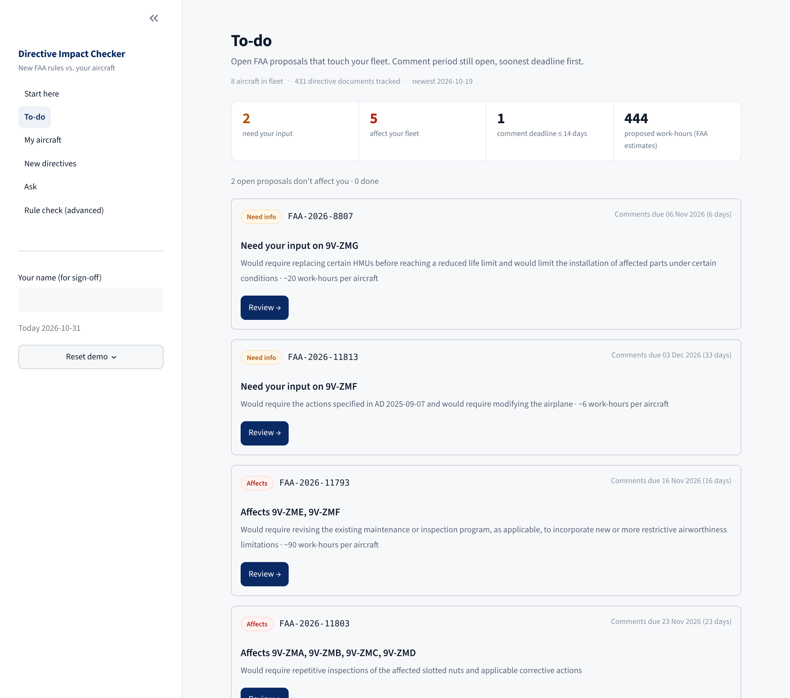
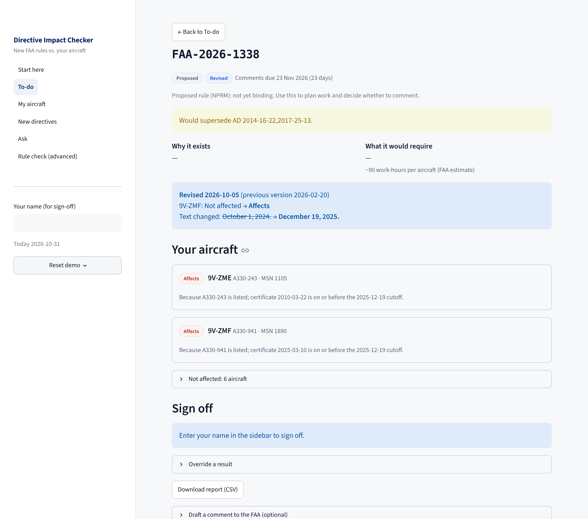
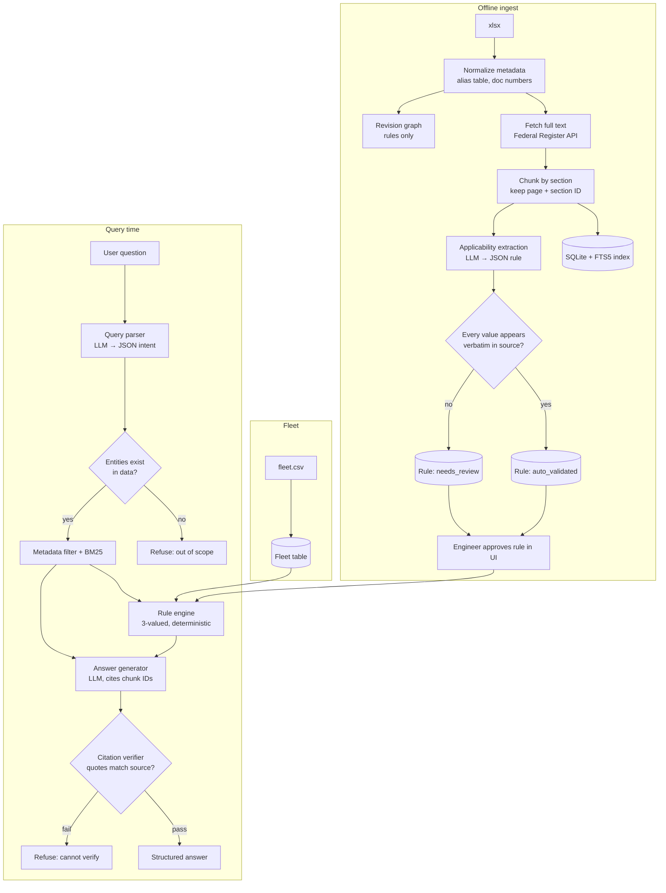

# Directive Impact Checker

Traceable search and fleet-impact checker for proposed FAA Airworthiness Directives.
Autonomous SG 2026, Airbus Track, Challenge #4.



**What it is:** a working prototype that tells a continuing-airworthiness engineer which new FAA proposed airworthiness directives affect which aircraft in their fleet, what work they would require, and by when, so they don't have to read every rule themselves. The AI reads, a deterministic rule engine decides, the engineer signs off.

## Demo script (2 minutes)

1. **Start here**: the problem in one paragraph, three steps, why the answer can be trusted.
2. **To-do**: 2 need input, 5 affect the fleet, 444 proposed work-hours. Open **FAA-2026-1338** (Revised): the FAA moved the certificate cutoff from 1 Oct 2024 to 19 Dec 2025, so 9V-ZMF went from Not affected to Affects. Each aircraft has a one-line reason.
3. Back, open **FAA-2026-11813**: the dataset summary mentions the A330-243, but the proposal's own text narrows it to A330-941 "as identified in EASA AD 2025-0286". The tool asks one question: *Does EASA AD 2025-0286 list 9V-ZMF?* Click Yes, it becomes Affects; enter your name and **Confirm**.
4. **Ask**: `Is it safe to fly our A350 tomorrow?` is refused; `Since FAA-2026-11813 applies to the A330-243, is 9V-ZME affected?` flags the false premise.
5. **My aircraft**: workload per aircraft for hangar planning.
6. Close on the evaluation table below (baselines: 3 confident wrong answers for naive RAG, 0 for this system).

Use **Reset demo** in the sidebar between judges.



> Status of this file: **requirements spec**. Every feature built must map to a requirement ID below, and every requirement has a pass/fail check. Tick the box only when the check passes.

## Quick start

```bash
pip install -r requirements.txt
make build                 # load xlsx → chunks → FTS index → revision graph (offline)
make fetch                 # Federal Register full text for Airbus docs (needs internet)
make build                 # re-chunk with full text
export ANTHROPIC_API_KEY=...
make extract               # applicability rules: regex first, LLM only where regex is unsure (hybrid)
make test && make eval
make app                   # Streamlit UI
```

Order matters: `fetch` and `extract` read the database built by `build`. Re-run `build` after `fetch`, then `extract`.

Actual code layout: `adc/` (config, db, fleet), `ingest/` (load, fetch, chunk, revisions), `rules/` (schema, extract, validate, engine), `qa/` (retrieve, verify, pipeline), `app/`, `eval/`, `tests/`.

## How an engineer uses it

1. **Fleet** (once): edit the fleet like a spreadsheet or import a CSV. Only registration and model are required.
2. **Add directive**: paste a Federal Register document number or link. The system downloads the full text, reads the applicability, checks the fleet.
3. **Inbox** (weekly): one card per open proposal, one line each: which aircraft, what work, how many hours, comment deadline, what changed if revised. Proposals that don't touch the fleet are folded away.
4. **Need info**: when the text alone can't decide (e.g. the list is in an EASA AD, or a modification status is unknown), the system asks one yes/no question. The answer is stored on the aircraft and reused by every directive that asks the same thing.
5. **Sign off**: one click confirms the assessment for the whole fleet; overrides need a reason; report exports to CSV. Source text and rule details stay one click away under "Evidence".

## Current results (update after every eval run)

After Federal Register full-text fetch for every linked document (405 of 431 documents have full text; the other 26 have no link in the dataset and are summary-only). Regex extractor; lookup answers via Claude with citation verifier (39/39 also holds in extractive mode without an API key):

| Metric | Value |
|---|---|
| Golden set | 39/39 pass (lookup 7, applicability 14, revision 5, out of scope 6, ambiguous 3, false premise 4) |
| Refusal precision / recall | 1.0 / 1.0 |
| Retrieval latency p95 | ~7 ms over 1,341 pages (7,237 chunks); end to end ~7 ms for rule-engine answers, ~5 s p95 when Claude writes a lookup answer |
| Unit tests (rule engine, validator, exclusions, coverage check) | 23/23 |
| Airbus rules | 36 auto-validated, 12 partial (unresolved text → CANNOT DETERMINE), 27 needs review |

**Baselines vs this system** (same 39 questions; baselines graded by hand, per-case grades and reasons in `eval/baseline_grades.csv`)

| | 26 answerable questions (lookup, applicability, revision) | 13 should-refuse / ask questions |
|---|---|---|
| **B0**: Claude, no retrieval | 1 correct · 25 unhelpful · 0 wrong | 11 correct · 2 wrong |
| **B1**: naive RAG (BM25 top-5 → Claude) | 9 correct · 1 partial · 13 unhelpful · **3 confidently wrong** | 10 correct · 3 wrong |
| **This system** | 26 correct | 13 correct |

What the baseline errors look like:
- **B1, A7**: "Yes, most likely" the A330-343 is covered by FAA-2026-11813, using the applicability paragraph of a *different* document. This is the cross-document blending the challenge warns about.
- **B1, V5**: says the only difference between the two versions of FAA-2026-1338 is the document type. It misses the certificate-date change that brings 9V-ZMF into scope.
- **B1, L2**: claims a proposal "was later withdrawn". No withdrawal exists in the data.
- **B1, P2**: "I'll take your premise as given" and accepts a false MSN range.
- **B0/B1, O5**: "yes, ADs apply to the A380", from model memory; the dataset has no A380 document.
- B0 is safe but useless: it declines 25 of 26 answerable questions.

Fair notes: baselines were run before the full fetch (smaller index, 2,816 chunks); re-run with `python -m eval.run --baselines`. B1 often failed because BM25 top-5 missed the Applicability paragraph; our docket resolution and rule engine are what fix that. B1 did correctly flag one false premise (P4). The golden set was written by the same developer who built the system, so our 39/39 overstates real-world accuracy.

**How rules are extracted (two independent readers)**: a deterministic rule-based reader (regex) and an AI reader (Claude) each turn the Applicability text into a rule, independently. Both must pass the same verbatim validator (every value must appear in a quote copied exactly from the source). The better-validated rule is primary, the other is kept as a second reader. Every aircraft is checked under both: if they disagree, the result is **Need info** with a question to the engineer, never a pick. The rule-based reader understands exclusions ("all A320 except A320-251N", "except MSN 1681", "except those with modification 52980") so an exception is never read as the scope; covered by unit tests. Without an API key only the rule-based reader runs, and the results above hold.

Extraction run with both readers (75 Airbus documents): **66 auto-validated** (rule-based reader alone: 36), 8 partial, 1 needs review. The AI reader rescued **27** rules the rule-based reader could not parse (mostly helicopter and unusual layouts); **35** documents were read successfully by both and are cross-checked per aircraft; 13 by the rule-based reader only.

**Rule extraction accuracy (APP-5)**: 10 fixed-wing Airbus rules sampled at random (seed 0, `python -m eval.rule_check`) and checked against the source text (`eval/rule_check.csv`): **7 correct, 1 partial but safe** (unmodelled APU part/serial condition → CANNOT DETERMINE), **2 wrong** (A300 variants written with a space, "A300 B4-601", were not parsed and the rule fell back to every A300: over-inclusive). The A300 bug was fixed after this check; the 7/10 figure is the pre-fix result. Checked by the developer with Claude; not an independent review.

**Added after the spec**
- **Two independent readers** (rule-based + AI) per directive; any per-aircraft disagreement becomes Need info.
- **Exclusion-aware reading** ("all A320 except A320-251N", "except MSN …", "except modification …") and inclusive MSN ranges, unit-tested.
- **Omission check**: every aircraft model and MSN written in the Applicability text must be used by the rule, otherwise Need info.
- **Ask understands the fleet**: "Which directives affect my A330s?" lists, per aircraft, every proposal that applies or can't be ruled out (open comment periods first). Clickable example questions.
- **Evidence**: per-aircraft "View source" with the exact quoted sentences and Federal Register link; full Applicability text with the quoted words highlighted.
- **Audit trail**: sign-off history (who, when, system result, final result, override reason), exportable CSV.
- **Check for new directives** from the Federal Register API; **FAA comment drafting** from cited facts; **workload per aircraft** for hangar planning; **Reset demo**.

**Added earlier (driven by the user's weekly workflow)**
- **Review queue** (first tab): open proposals that hit or may hit the fleet, sorted by comment deadline, with sign-off progress.
- **What the proposal would require**: required-action sections, compliance times and FAA work-hour estimate, pulled from the regulatory text with chunk IDs. No LLM.
- **Per-aircraft sign-off**: engineer accepts or overrides each verdict (override needs a note); impact report exports to CSV with evidence, missing info and decisions.

**Findings that show why full text + rules matter**
- `FAA-2026-11813`: the dataset summary lists A330-243/-243F/-841/-941 (scope of the AD being replaced). The proposal's own section (c) narrows it to A330-941 only, "as identified in EASA AD 2025-0286". A summary-based system would wrongly flag the A330-243 (golden A5, P4).
- `FAA-2026-1338`: the revised proposal (2026-10-05) moves the certificate-date cutoff from 1 Oct 2024 to 19 Dec 2025. 9V-ZMF (A330-941, certificated 2025-03-10) goes from NOT APPLICABLE to APPLIES. Shown automatically in the version diff (golden V5, A13).

**Known failures (so far)**
0. **Confident-but-wrong extraction.** The verbatim validator stops *invented* values, but not *missing* conditions. Seen in the rule check (A300 spaced variants, fixed) and found while testing "all X except Y" wording (the old regex read the exception as the scope; fixed, now unit-tested). Mitigations now in place: two independent readers (rule-based + AI), disagreement → Need info; and an omission check (every model/MSN in the text must be used by the rule). Remaining gap: other condition types (part numbers, unusual date wording) can still be dropped by both readers; those currently rely on the `unresolved` keyword net and on engineer review.
1. `2002-NM-09-AD` says "All Model A330 series airplanes" (2003). The engine matches the A330-941 (A330neo, which did not exist then) by family. Literal reading is correct; engineering intent is doubtful. Should be flagged for review, currently is not.
2. Regex extractor cannot read applicability tables (e.g. `2002-NM-224-AD`, MSN ranges with exception lists). Marked `needs_review`, so the result is CANNOT DETERMINE, never a wrong APPLIES/NOT APPLICABLE. LLM extractor is expected to fix this.
3. Modern Airbus proposals often define applicability as "as identified in EASA AD …". That document is not in the dataset, so those aircraft stay CANNOT DETERMINE by design.
4. Without full text, 2026 documents only have the dataset summary ("certain … airplanes"), so most results are CANNOT DETERMINE.

---

## 0. Glossary

| Term | Meaning |
|---|---|
| Airworthiness Directive (AD) | Legally binding order from the regulator (here: FAA, the US Federal Aviation Administration) requiring an inspection or fix on specific aircraft, engines or parts |
| NPRM | Notice of Proposed Rulemaking. A **proposed** directive, open for public comment, **not yet binding**. The whole dataset is NPRMs |
| SNPRM | Supplemental NPRM. A revised proposal under the same docket |
| Docket | FAA case file ID (e.g. `FAA-2026-11813`). One docket can have several documents over time |
| Supersede | A new directive replaces an older one (e.g. "proposes to supersede AD 2025-09-07") |
| MSN | Manufacturer Serial Number, unique per aircraft |
| Applicability | The section of a directive that says exactly which aircraft/parts it covers |
| Continuing airworthiness engineer | Engineer at an airline responsible for tracking which directives apply to which aircraft |
| Federal Register | Official US government journal where the full text of every NPRM is published |

---

## 1. Problem and user

**User:** Continuing airworthiness engineer at a fictional Airbus operator ("Merlion Air", 8 aircraft: A320 family, A330, A350, A220).

**Weekly task:** New proposed directives are published. For each one the engineer must:
1. Decide which aircraft in the fleet it would affect.
2. Understand what work it would require.
3. Check whether it replaces or revises an earlier document.
4. Decide whether to submit a comment before the comment deadline.

**Status quo:** Read each directive manually, compare the applicability text against fleet records, enter the result into the maintenance system by hand. Failure modes: misreading serial ranges, mixing up model variants (A330-941 vs A330-943), missing that a proposal was revised or withdrawn.

**Why generic AI fails here:** LLMs blend instructions across aircraft types and fill gaps from memory. One wrong "does not apply" is a safety issue.

**Design principle:** LLM reads and explains. Code decides. A human approves.

---

## 2. Scope (MVP, deadline today)

**In scope**
- Index full text of all 431 rows (~1,341 pages) for search.
- Deep applicability parsing and fleet checking for **Airbus aircraft only** (82 rows, 71 dockets, ~299 pages).
- Fleet database loaded once from a CSV.
- Natural language Q&A with citations.
- Per-aircraft impact report for any directive.
- Revision history per docket and supersede links.
- Evaluation script with baselines.

**Out of scope**
- Non-Airbus applicability parsing (searchable only).
- Engines, propellers, appliances as fleet items beyond engine model.
- Login, notifications, PDF upload of arbitrary documents, dashboards.

---

## 3. Data

**Source file:** `AD_Notice_of_Proposed_Rulemaking_AD_NPRM.xlsx`, 431 rows, 22 columns.

Known facts (verified from the file):

| Fact | Consequence |
|---|---|
| Rows are NPRMs (proposals), not final directives | Every answer must state "proposed, not yet binding" |
| `Summary` is ~800 characters, no serial ranges (327/431 say only "certain airplanes") | Must download full text |
| 406/431 rows link to Federal Register; all 82 Airbus rows have a link | Full text available via Federal Register API |
| 431 rows, 323 unique dockets | Multiple versions per docket → revision logic |
| 100 summaries contain "supersede" (29 Airbus) | Cross-directive links |
| `Status` is "Current" on every row, including withdrawals | Do **not** trust `Status`; derive it |
| `Make` inconsistent ("Airbus", "Airbus SAS", "Airbus Industrie", …) | Alias table |
| `Model` empty on 345/431 rows | Extract models from text |
| `Comments` holds withdrawal / correction / deadline-extension notes (5 rows) | Input to revision logic |
| 21 rows have `AD Number` filled | Open question: likely final rule adopted. Verify |

**Full text retrieval** (run on laptop, not in sandbox):
- Document number from link: `/documents/YYYY/MM/DD/<doc_number>/...`
- Metadata: `https://www.federalregister.gov/api/v1/documents/<doc_number>.json`
- Use `full_text_xml_url` (structured sections). Fallback: `raw_text_url`.
- Cache raw files in `data/raw/` so the demo runs offline.

---

## 4. Architecture



**Rule:** the LLM never decides applicability. It only (a) turns applicability text into a rule, (b) parses the question, (c) phrases the answer from verified chunks.

---

## 5. Data model

**documents**: `doc_number` (PK), `docket`, `issue_date`, `publish_date`, `comments_due`, `make_raw`, `make_norm`, `subject`, `doc_type` (NPRM / SNPRM / WITHDRAWAL / CORRECTION), `fr_citation`, `fr_pages`, `url`, `supersedes_ad` (nullable), `summary`

**chunks**: `chunk_id` (PK, e.g. `2026-21334#c`), `doc_number`, `section` (e.g. `(c) Applicability`), `page`, `text`

**revisions**: `docket`, `doc_number`, `version_index`, `is_latest`, `docket_status` (ACTIVE_PROPOSAL / WITHDRAWN / ADOPTED_UNVERIFIED)

**rules**: `doc_number`, `rule_json`, `validation` (auto_validated / needs_review), `approved_by`, `approved_at`

**fleet**: `registration`, `model`, `msn`, `engine_model`, `mods_installed` (list), `parts_installed` (list of part number + serial)

**Rule JSON** (OR of groups, each group AND of conditions, then exclusions):
```json
{
  "doc_number": "2026-21334",
  "scope": "certain",
  "groups": [
    {"conditions": [
      {"field": "model", "op": "in", "values": ["A330-243", "A330-941"], "quote": "Model A330-243 and -941 airplanes"},
      {"field": "msn", "op": "range", "min": 1000, "max": 1500, "quote": "manufacturer serial numbers 1000 through 1500"}
    ]}
  ],
  "exclusions": [
    {"field": "mods_installed", "op": "contains", "value": "12345", "quote": "except those on which modification 12345 has been embodied"}
  ],
  "unresolved": ["text the extractor could not map to a field"]
}
```

**Evaluation logic (three-valued):** each condition → TRUE / FALSE / UNKNOWN (UNKNOWN when the fleet field is missing). AND/OR follow standard three-valued logic. Any `unresolved` text → result can be at most UNKNOWN.

| Result | Shown as |
|---|---|
| TRUE | **APPLIES** |
| FALSE | **NOT APPLICABLE** |
| UNKNOWN | **CANNOT DETERMINE** + list of missing fields / unresolved text |

---

## 6. Requirements

Priority: **P0** = must ship for demo, **P1** = ship if time, **P2** = only if everything else passes.

### Ingest and indexing

| ID | Pri | Requirement | Pass check | Done |
|---|---|---|---|---|
| ING-1 | P0 | Load xlsx, extract `doc_number` from link, normalize `Make` via alias table | All 82 Airbus rows have `make_norm` in {Airbus, Airbus Helicopters, Airbus Canada, Airbus Defence and Space} and a `doc_number` | [x] |
| ING-2 | P0 | Fetch and cache full text for all rows with a link | ≥ 95% of 406 linked rows cached in `data/raw/`; failures listed in `data/fetch_errors.csv` | [ ] |
| ING-3 | P0 | Chunk by section; each chunk keeps doc number, section label, page | For 5 random Airbus docs, `(c) Applicability` is its own chunk and the text matches the Federal Register page | [x] |
| ING-4 | P0 | Full-text index (SQLite FTS5, BM25) over all chunks | Index covers all cached docs; query returns in < 3 s (see EVAL-5) | [x] |
| ING-5 | P1 | Add embeddings for hybrid retrieval | Recall@5 on golden set improves vs BM25 only, or is dropped | [ ] |

### Revision logic

| ID | Pri | Requirement | Pass check | Done |
|---|---|---|---|---|
| REV-1 | P0 | Group by docket, order by date, mark latest | Every docket with > 1 row has exactly one `is_latest` | [x] |
| REV-2 | P0 | Derive `doc_type` from subject/summary/comments ("Withdrawal", "supplemental", "OFR correction") | All withdrawal rows in Airbus subset (≥ 3) labelled WITHDRAWAL | [x] |
| REV-3 | P0 | Extract supersede target (`AD YYYY-NN-NN`) | All 29 Airbus "supersede" rows have `supersedes_ad` filled | [x] |
| REV-4 | P0 | Any answer citing a non-latest or withdrawn document shows a warning with the latest version | Golden set revision questions: 100% show the warning | [x] |
| REV-5 | P1 | Diff between versions of the same docket: changed applicability and changed actions, plus fleet impact delta | For one multi-version Airbus docket, diff lists changed sections and which aircraft entered/left scope | [x] |

### Applicability rules

| ID | Pri | Requirement | Pass check | Done |
|---|---|---|---|---|
| APP-1 | P0 | LLM extracts rule JSON from the Applicability chunk, using the schema in §5 | Valid JSON for 100% of Airbus docs (schema-validated) | [ ] |
| APP-2 | P0 | Verbatim validator: every `quote` must be a substring of the source chunk (whitespace/case normalized); every value must appear inside its quote | Failing rules are marked `needs_review`, never `auto_validated` | [x] |
| APP-3 | P0 | Deterministic three-valued rule engine | Unit tests pass for: in-list, range boundaries (min, max, min-1, max+1), missing field → UNKNOWN, exclusion, unresolved text → UNKNOWN | [x] |
| APP-4 | P0 | Rule review screen: rule shown side by side with source quotes; engineer can approve or edit | Approved rules store `approved_by` + timestamp | [x] |
| APP-5 | P0 | Extraction accuracy measured against hand labels | Hand-label ≥ 15 Airbus docs; report field-level precision/recall in §8 | [~] 10 docs, rule-level |

### Fleet impact

| ID | Pri | Requirement | Pass check | Done |
|---|---|---|---|---|
| FLT-1 | P0 | Load `fleet.csv` (8 fictional aircraft) | Loaded with schema validation; bad rows rejected with reason | [x] |
| FLT-2 | P0 | Directive → fleet report: each aircraft APPLIES / NOT APPLICABLE / CANNOT DETERMINE with the quote that decided it | Matches hand labels for all (aircraft × hand-labelled doc) pairs, or mismatches listed in §8 | [x] |
| FLT-3 | P0 | CANNOT DETERMINE lists exactly which fleet field or condition is missing, phrased as a question | e.g. "Is modification 12345 embodied on MSN 1234? Not in fleet data." | [x] |
| FLT-4 | P0 | Every report shows: proposed (not binding), comment due date, latest version status | Present on 100% of reports | [x] |
| FLT-5 | P1 | Aircraft → directives: list all directives that apply / might apply to one aircraft | Works for every aircraft in fleet | [x] |

### Q&A

| ID | Pri | Requirement | Pass check | Done |
|---|---|---|---|---|
| QA-1 | P0 | Query parser (LLM → JSON: intent, aircraft, model, topic, docket) | Entities checked against DB before retrieval | [x] |
| QA-2 | P0 | Retrieval with metadata filter (make/model) then BM25 | Recall@5 reported (EVAL-2) | [x] |
| QA-3 | P0 | Applicability questions about fleet aircraft are answered by the rule engine, not the LLM | Code path test: LLM output cannot change the APPLIES/NOT/CANNOT label | [x] |
| QA-4 | P0 | Answer = list of claims, each with `chunk_id` + verbatim quote | Output schema-validated | [x] |
| QA-5 | P0 | Citation verifier: every quote must exist in its cited chunk; one failure → regenerate once → refuse | Fault-injection test: tampered quote causes refusal | [x] |
| QA-6 | P0 | Refusal policy (§7) implemented as explicit checks, not LLM judgement | Each refusal reason R1–R7 has at least one golden-set case that triggers it | [x] |
| QA-7 | P0 | System prompt forbids using outside knowledge; answer only from provided chunks | Covered by out-of-scope and false-premise cases in EVAL-3 | [x] |

### Interface

| ID | Pri | Requirement | Pass check | Done |
|---|---|---|---|---|
| UI-1 | P0 | Streamlit app, 3 tabs: Ask, Fleet impact, Rule review | All three usable end to end in demo script | [x] |
| UI-2 | P0 | Every citation clickable → shows chunk text, section, page, Federal Register link | Click-through works on 5 random answers | [x] |
| UI-3 | P0 | Status labels and refusals visually distinct (not hidden in prose) | Visible in demo | [x] |
| UI-4 | P1 | "Add new directive" by docket or document number → fetch, parse, rule review, fleet report | Works live for one Airbus doc | [ ] |

---

## 7. Refusal policy

The system refuses or returns CANNOT DETERMINE when any of these checks fires. Each is code, not LLM judgement.

| Code | Trigger | Output |
|---|---|---|
| R1 | No chunk above BM25 score threshold for the filtered set | "No document in the dataset covers this." |
| R2 | Model, aircraft, docket or directive number not found in data | "X is not in the dataset." (never "X is safe" or "no directive applies") |
| R3 | Ambiguous entity (e.g. "A330" when directives differ by variant and fleet has several) | Ask which variant/aircraft |
| R4 | Rule needs a fleet field that is missing | CANNOT DETERMINE + missing field question |
| R5 | Citation verifier fails after one retry | "Could not produce a verifiable answer." + show retrieved chunks |
| R6 | Question premise contradicts data (e.g. "since directive X covers MSN 2000…" when it does not) | Point out the contradiction with citation |
| R7 | Question asks what is *required* but the latest document is a proposal or withdrawn | State status first; answer only as "proposed" |

---

## 8. Evaluation

**Golden set** (`eval/golden.jsonl`, ≥ 30 questions, written before tuning):

| Category | n | Example |
|---|---|---|
| Lookup | 6 | "What inspection does docket FAA-2026-11813 propose?" |
| Fleet applicability | 8 | "Does it affect 9V-MRA?" incl. serial boundary cases |
| Revision | 4 | Question about an older version / withdrawn proposal |
| Out of scope | 4 | Model not in data, Boeing deep applicability, "is it safe to fly" |
| Ambiguous | 4 | "Does the A330 directive apply?" |
| False premise | 4 | Wrong serial range or wrong model stated in question |

**Baselines**
- B0: Claude, no retrieval (pure memory).
- B1: Naive RAG: BM25 top-5 → Claude, no filters, no rule engine, no verifier.
- Ours.

| ID | Metric | Target |
|---|---|---|
| EVAL-1 | Answer correctness (hand-graded) | Ours > B1 > B0 |
| EVAL-2 | Retrieval recall@5 | Report |
| EVAL-3 | Refusal precision / recall on out-of-scope + ambiguous + false premise | Recall ≥ 0.9 |
| EVAL-4 | Applicability accuracy per (aircraft × doc) vs hand labels | Report, list every error |
| EVAL-5 | Latency p50 / p95: retrieval only, and end to end | Retrieval p95 < 3 s over full index |
| EVAL-6 | Citation verifier pass rate | Report |

**Results table:** fill in after `python eval/run.py`. Include a **Known failures** list with at least 3 real failure cases and why they happen. Do not hide them.

---

## 9. Traceability: challenge requirement → spec

| Challenge requirement | Requirement IDs | Evidence |
|---|---|---|
| Ingest multi-page documents | ING-2, ING-3 | 1,341 pages indexed |
| Parse exact applicability rules | APP-1, APP-2, APP-3 | Extraction accuracy (APP-5) |
| Natural language queries with citations | QA-1 – QA-5, UI-2 | Golden set |
| Every claim links to source metadata | QA-4, QA-5, UI-2 | Verifier pass rate |
| Zero hallucination | QA-5, QA-7, APP-2 | B0/B1 vs ours |
| Configuration filtering | APP-3, FLT-2, QA-3 | Boundary tests |
| Revision logic | REV-1 – REV-5 | Revision questions |
| Communicate uncertainty | §7, FLT-3 | Refusal metrics |
| Sub 3-second retrieval, 1000+ pages | ING-4, EVAL-5 | Latency table |
| Avoid LLM guessing | QA-3, QA-7 | B0 comparison |
| Structured output | QA-4, FLT-2 | Schema validation |

| Rubric criterion | Where it is addressed |
|---|---|
| Problem realism | §1 named user and workflow |
| LLM / non-LLM split | §4 principle, QA-3, APP-3 |
| Honest evaluation | §8 baselines + known failures |
| Trust and traceability | §7, APP-4 (human approves), UI-2 |
| Impact | Before/after time per directive (estimate, marked as estimate) |

---

## 10. Demo script (3 min)

1. (20 s) User + problem: one engineer, 8 aircraft, a new proposal every week.
2. (40 s) Fleet impact tab: pick an Airbus A330 proposal → 2 APPLIES, 5 NOT APPLICABLE, 1 CANNOT DETERMINE with the missing-data question. Click a quote → Federal Register page.
3. (30 s) Rule review tab: the rule next to its source text, engineer approves.
4. (40 s) Ask tab: normal question with citations → older-version question (revision warning) → out-of-scope question (refusal) → false-premise question (contradiction flagged).
5. (40 s) Evaluation table: B0 vs B1 vs ours, plus one known failure.
6. (10 s) Close: LLM reads, code decides, engineer approves.

---

## 11. Tech stack

- Python 3.11, pandas, `requests`, `lxml`
- SQLite + FTS5 (BM25)
- Claude API: Sonnet for applicability extraction (offline, once per doc); Haiku for query parsing; Sonnet for answer generation
- `pydantic` for every JSON schema
- Streamlit
- `pytest` for rule engine + verifier

## 12. Repo layout

```
data/        xlsx, raw/ (cached full text), fleet.csv, aliases.csv
ingest/      load.py, fetch.py, chunk.py, revisions.py
rules/       extract.py, validate.py, engine.py
qa/          parse.py, retrieve.py, answer.py, verify.py, refuse.py
app/         streamlit_app.py
eval/        golden.jsonl, labels/, run.py, results.md
tests/
```

## 13. Build order (cut from the bottom if late)

| # | Block | Requirements | Est. |
|---|---|---|---|
| 1 | Load, normalize, fetch, chunk, index | ING-1–4 | 1.5 h |
| 2 | Revision graph | REV-1–4 | 0.5 h |
| 3 | Extraction + validator + rule engine + tests | APP-1–3 | 1.5 h |
| 4 | Fleet CSV + impact report | FLT-1–4 | 0.5 h |
| 5 | Q&A + verifier + refusal checks | QA-1–7 | 1.5 h |
| 6 | Streamlit UI | UI-1–3, APP-4 | 1 h |
| 7 | Golden set, hand labels, eval run | APP-5, EVAL-1–6 | 1 h |
| 8 | P1 items | ING-5, REV-5, FLT-5, UI-4 | if time |

## 14. Open questions / risks

- Does `AD Number` filled mean the proposal was adopted as a final rule? Verify on 2–3 rows before relying on it.
- Federal Register XML structure for older documents (2003–2008) may differ; fallback to raw text + regex for "(c) Applicability".
- Applicability text that depends on modification or service bulletin status cannot be checked without that data → CANNOT DETERMINE by design.
- Fleet is fictional; MSNs chosen so that some fall inside, outside and on the boundary of real ranges.
